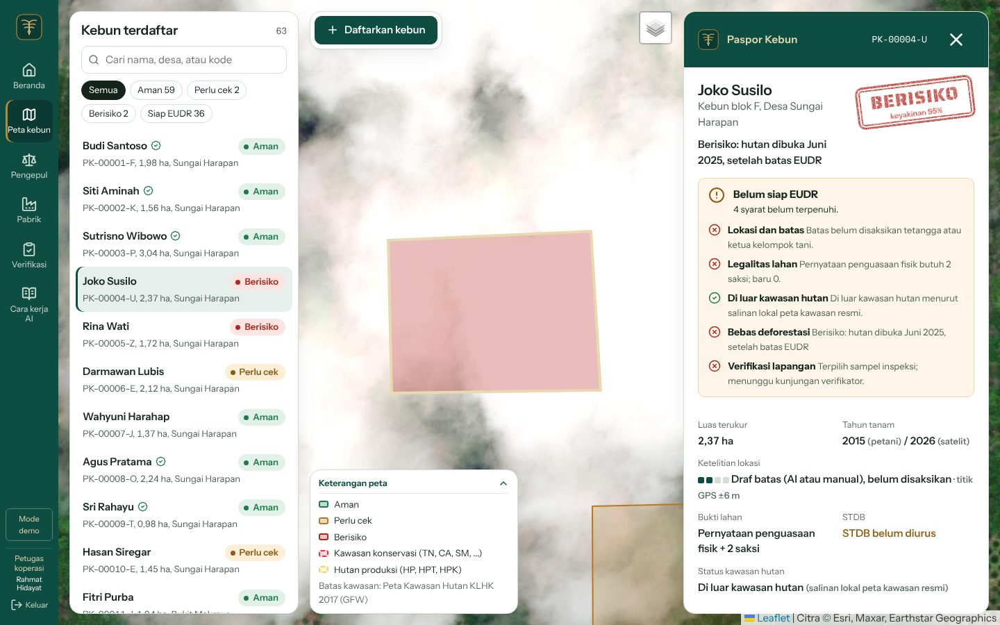
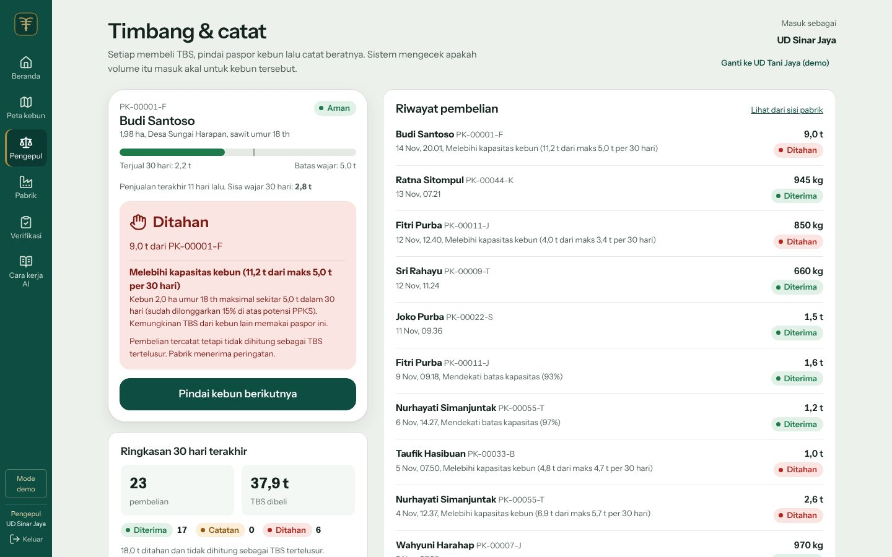
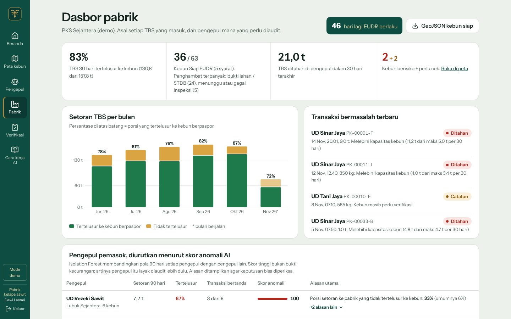
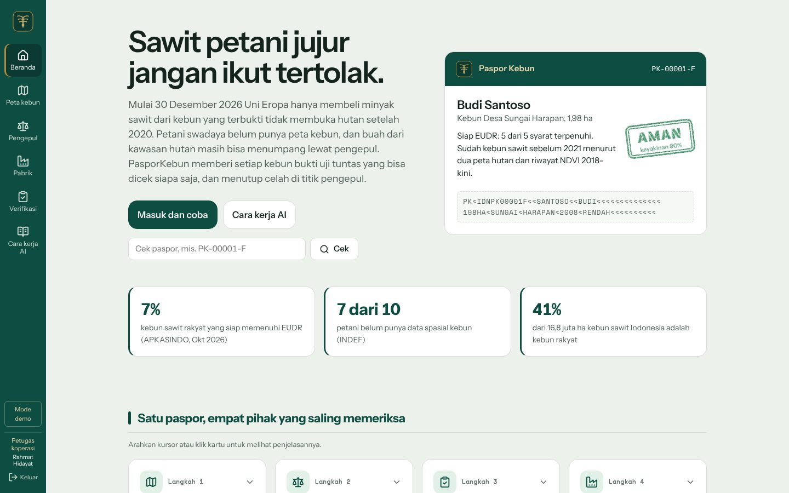
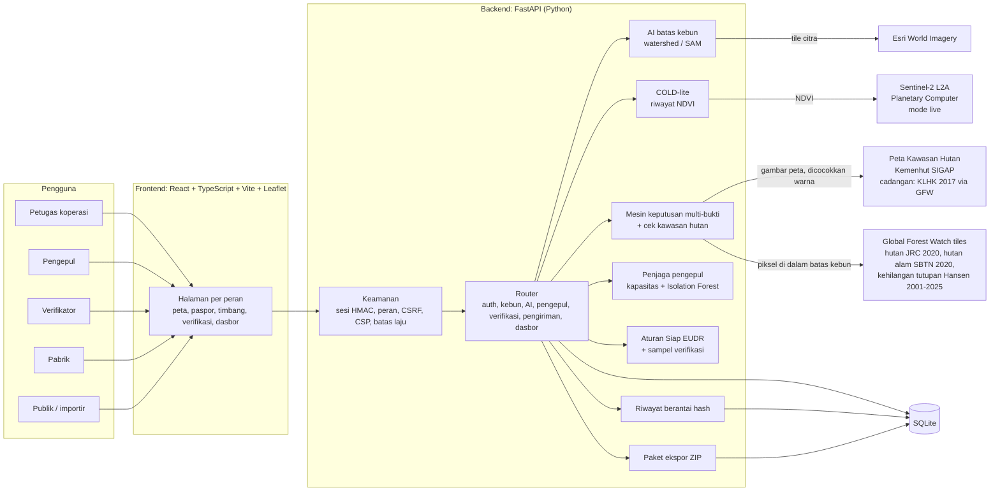
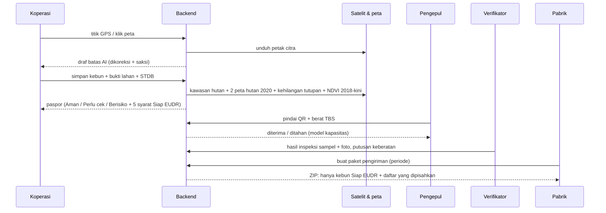

# PasporKebun

**Paspor digital kebun sawit rakyat: bukti uji tuntas EUDR yang bisa dicek siapa saja, dan penjaga di titik pengepul.**

| | |
|---|---|
| Kategori | **Web** |
| Subtema | **Local MSME & Creative Economy**: petani sawit swadaya (usaha mikro) tetap punya akses ke pasar ekspor. Dampak lingkungannya: mencegah buah dari hutan yang baru dibuka masuk rantai pasok |
| Tim | _[isi nama tim]_ |
| Anggota | _[isi: nama, peran, akun GitHub]_ |
| Aplikasi ter-deploy | _[isi URL setelah deploy, lihat bagian Deploy]_ |
| Video demo | _[isi tautan YouTube]_ |

**Isi:** [Ringkasan](#ringkasan) · [Coba dalam 5 menit](#coba-dalam-5-menit-untuk-juri) · [Istilah](#istilah) ·
[Masalah](#masalah) · [Solusi](#solusi-dan-target-pengguna) · [Cara kerja](#cara-kerja-dari-kebun-sampai-pengiriman) ·
[Fitur](#fitur-yang-berhasil-diimplementasikan) · [Arsitektur](#arsitektur-sistem) · [Teknologi](#teknologi) ·
[Instalasi](#instalasi-dan-menjalankan-laptop-windows) · [Akun demo](#akun-demonstrasi) · [AI](#dokumentasi-penggunaan-ai) ·
[Data nyata vs simulasi](#data-nyata-vs-simulasi) · [Keamanan](#keamanan-dan-privasi) · [Keterbatasan](#keterbatasan-yang-kami-ketahui) ·
[Atribusi](#atribusi)

---

## Ringkasan

PasporKebun adalah aplikasi web untuk koperasi petani sawit swadaya. Mulai 30 Desember 2026, minyak sawit yang dijual ke
Uni Eropa harus bisa dibuktikan berasal dari kebun yang jelas lokasinya, legal, dan tidak membuka hutan setelah 2020.
Petani kecil umumnya tidak punya peta kebun maupun bukti itu, sehingga buahnya terancam tidak bisa dijual ke pabrik eksportir.

Aplikasi ini membuat **paspor digital untuk setiap kebun**:

1. Petugas koperasi memetakan kebun bersama petani: titik GPS, **AI menggambar draf batas** dari citra satelit, lalu
   petani dan tetangga sebagai saksi mengoreksinya.
2. Server mengecek kebun ke **peta kawasan hutan resmi** dan **dua peta hutan satelit**, lalu memberi status
   **Aman / Perlu cek / Berisiko** beserta checklist **Siap EUDR** yang menyebut apa yang masih kurang.
3. Saat buah dijual, **pengepul memindai QR** paspor. Volume yang mustahil untuk luas dan umur kebun itu **ditahan**, jadi
   buah dari kebun lain tidak bisa menumpang paspor.
4. **Verifikator** mendatangi sampel kebun berbasis risiko, dan **pabrik** mengunduh paket bukti untuk importir Eropa.

| | |
|---|---|
|  |  |
| **Paspor kebun**: cap Berisiko, alasannya, dan 5 syarat Siap EUDR | **Pengepul**: 9 t dari kebun 2 ha langsung ditahan |
|  |  |
| **Pabrik**: TBS tertelusur, pengepul diurutkan menurut skor anomali AI | **Beranda** dan cek paspor publik |

## Coba dalam 5 menit (untuk juri)

Buka aplikasi ter-deploy (tautan di tabel atas) atau jalankan lokal (lihat [Instalasi](#instalasi-dan-menjalankan-laptop-windows)).

1. **Masuk dan coba** → klik kartu **Petugas koperasi** (tanpa mengetik kata sandi).
2. **Peta kebun** → klik **Joko Susilo (PK-00004-U)**: cap Berisiko karena hutan dibuka Juni 2025, checklist Siap EUDR,
   dan bukti satelit beserta sumbernya.
3. Klik **Sutrisno Wibowo (PK-00003-P)**: tutupan pohon hilang tahun 2023, tetapi lahannya bukan hutan pada 2020, jadi
   tetap Aman (peremajaan sawit, bukan deforestasi).
4. **Daftarkan kebun** → **Tunjuk di peta** → klik tengah sebuah kebun di citra: AI menggambar draf batas. Isi data lalu
   simpan; paspor langsung dianalisis.
5. Keluar, lalu di halaman Masuk klik kartu **UD Sinar Jaya** (pengepul) → ketik `PK-00001-F`, **Cari**, berat `9000`
   → **Ditahan** karena melebihi kapasitas kebun.
6. Masuk sebagai **Pabrik** → lihat skor anomali pengepul → **Buat paket** pengiriman ekspor (ZIP).
7. **Cara kerja AI** → **Jalankan uji sekarang**: enam kebun uji diperiksa ke peta online saat itu juga (butuh internet).

## Istilah

| Istilah | Arti |
|---|---|
| EUDR | Regulasi Uni Eropa anti-deforestasi (2023/1115). Komoditas seperti sawit hanya boleh masuk UE bila bebas deforestasi setelah 31 Des 2020, legal, dan disertai geolokasi kebun |
| Uji tuntas (*due diligence*) | Kumpulan bukti yang wajib disiapkan importir untuk membuktikan syarat EUDR |
| TBS | Tandan buah segar sawit, yang dijual petani |
| Pengepul | Pedagang perantara yang membeli TBS dari banyak petani lalu menyetorkannya ke pabrik |
| PKS | Pabrik kelapa sawit, pengolah TBS menjadi minyak sawit mentah |
| STDB | Surat Tanda Daftar Budidaya, pendaftaran kebun rakyat di bawah 25 ha ke pemerintah daerah |
| ISPO / RSPO | Sertifikasi sawit berkelanjutan (wajib nasional / sukarela internasional) |
| PSR | Peremajaan sawit rakyat: menebang sawit tua untuk ditanam ulang. Terlihat seperti "pohon hilang" di citra satelit, padahal bukan deforestasi |
| Kawasan hutan / APL | Lahan yang ditetapkan negara sebagai hutan / Areal Penggunaan Lain (boleh untuk kebun) |
| NDVI | Indeks kehijauan vegetasi dari citra satelit; turun tajam saat lahan dibuka |
| TRACES | Sistem informasi Komisi Eropa tempat geolokasi kebun diunggah |

## Masalah

| Fakta | Sumber |
|---|---|
| Mulai 30 Desember 2026 Uni Eropa hanya menerima minyak sawit yang terbukti tidak berasal dari deforestasi setelah 31 Des 2020, lengkap dengan geolokasi kebun asal | Regulasi (UE) 2023/1115 jo. 2025/2650 |
| Baru ~7% kebun sawit rakyat siap EUDR; STDB baru dimiliki sebagian kecil dari 6,8 juta ha kebun rakyat | APKASINDO (Okt 2026); EFI (2023) |
| 7 dari 10 petani belum punya data spasial kebun | INDEF |
| TBS dari kawasan hutan (mis. TN Tesso Nilo) tetap mengalir ke pabrik lewat pengepul | Mongabay, 30 Apr 2026 |
| Mengurus STDB di Kalimantan Tengah sekitar Rp415.000/ha karena pemetaan manual | EFI (2023) |

Akar masalahnya: **petani swadaya tidak punya bukti kebun yang dipercaya**, dan **pengepul adalah titik buta** tempat TBS
ilegal bercampur dengan TBS legal.

## Solusi dan target pengguna

PasporKebun memberi setiap kebun sebuah paspor: geolokasi, bukti lahan, hasil cek satelit dan peta kawasan hutan, serta
hasil verifikasi lapangan. Paspor dipakai di empat titik:

| Pengguna | Yang dilakukan di aplikasi |
|---|---|
| **Petugas koperasi** (pengguna utama) | Memetakan kebun bersama petani dan saksi: GPS "saya di kebun", draf batas AI, ciri batas tiap sisi, bukti lahan, STDB |
| **Pengepul** | Memindai kartu QR petani dan mencatat berat TBS; volume yang mustahil langsung ditahan |
| **Verifikator independen** | Mengunjungi sampel kebun berbasis risiko, mengunggah foto bergeotag, memutuskan keberatan |
| **Pabrik / eksportir** | Melihat porsi TBS tertelusur, pengepul yang perlu diaudit, dan membuat paket data uji tuntas untuk importir |
| **Petani & publik** | Membawa kartu QR (tanpa perlu ponsel); siapa pun bisa mengecek status paspor di `/cek/<kode>` |

PasporKebun **bukan sertifikat ISPO/RSPO** (itu hanya boleh diterbitkan lembaga sertifikasi terakreditasi KAN/ASI).
Paspor adalah bukti uji tuntas yang membuat sertifikasi kelompok dan pelaporan EUDR lebih murah.

## Cara kerja: dari kebun sampai pengiriman

**Status kebun** dihitung otomatis dari peta, per piksel di dalam batas kebun:

| Status | Kapan |
|---|---|
| **Berisiko** | Lebih dari 5% kebun masuk kawasan hutan (peta resmi Kemenhut), **atau** paling sedikit 10% kebun adalah hutan pada 2020 menurut **dua** peta hutan (JRC dan hutan alam SBTN) dan tutupannya hilang setelah 2020. Bila peta kedua tidak terbaca, dipakai satu peta dan paspor mencatatnya |
| **Perlu cek** | Bukti tidak cukup untuk menyimpulkan: dua peta hutan tidak sepakat, ada hutan 2020 tanpa kehilangan tutupan, atau peta belum terbaca. Kebun ini masuk prioritas kunjungan verifikator |
| **Aman** | Bukan hutan pada 2020 dan tidak ada pembukaan setelahnya, atau pembukaan terjadi di lahan yang bukan hutan (peremajaan sawit) |

Selama kedua peta hutan terbaca, satu peta saja tidak cukup untuk memvonis deforestasi, karena peta global bisa salah.
Petani bisa mengajukan keberatan; yang memutuskan verifikator manusia dengan alasan tertulis. Rincian aturan: [docs/ALGORITMA.md](docs/ALGORITMA.md).

**Siap EUDR** berarti kelima syarat ini terpenuhi (berlaku 12 bulan):

1. **Lokasi dan batas**: poligon atau titik GPS, batas disaksikan tetangga atau ketua kelompok tani.
2. **Legalitas lahan**: sertifikat, surat desa, atau pernyataan penguasaan fisik + 2 saksi; STDB sudah ada atau sedang
   diurus; petani menyetujui pemakaian data; tidak ada sengketa.
3. **Di luar kawasan hutan** menurut peta resmi.
4. **Bebas deforestasi**: status satelit Aman.
5. **Verifikasi lapangan**: tidak ada inspeksi yang tertunda atau gagal.

**Keputusan di pengepul** (setiap pembelian TBS):

| Keputusan | Kapan |
|---|---|
| **Ditahan** | Kebun Berisiko, tanaman belum 3 tahun, atau total jual 30 hari melebihi kapasitas kebun (potensi produksi PPKS menurut luas dan umur, dilonggarkan 15%) |
| **Catatan** | Kebun masih Perlu cek, berat satu kali jual tidak wajar, jual 3 kali dalam 7 hari, atau paspor dipakai pengepul lain dalam 3 hari |
| **Diterima** | Tidak ada tanda di atas |

TBS yang ditahan tetap tercatat, tetapi tidak dihitung sebagai TBS tertelusur, dan pabrik menerima peringatannya.

## Dampak dan rencana realisasi

| | |
|---|---|
| Pengguna harian | Petugas koperasi (memetakan kebun dan memelihara paspor); pengepul di titik pembelian TBS |
| Yang membayar | Pabrik / eksportir, karena merekalah yang wajib membuktikan asal TBS kepada importir UE. Petani gratis |
| Manfaat bagi petani | TBS tetap bisa masuk rantai pasok ekspor; peta kebun dipakai lagi untuk STDB dan ISPO; peremajaan sawit (PSR) tidak dianggap deforestasi; ada jalur keberatan |
| Pilot | 1 koperasi (sekitar 100 kebun) + 1 pabrik mitra sebelum kewajiban EUDR 30 Desember 2026 |
| Ukuran keberhasilan | % kebun Siap EUDR (titik awal nasional sekitar 7%), % TBS tertelusur ke kebun, ton TBS ditahan di pengepul, biaya pemetaan per ha dibanding Rp415.000/ha |
| Biaya menjalankan | Satu container CPU tanpa API AI berbayar (lihat Efisiensi sumber daya) |

## Fitur yang berhasil diimplementasikan

1. **Masuk berperan** (koperasi, pengepul, pabrik, verifikator, admin) dengan akun demo satu klik untuk juri.
2. **Pendaftaran kebun**: GPS "Saya sedang di kebun" (rata-rata beberapa bacaan), AI penggambar batas dari citra satelit,
   gambar manual, "Rapikan dengan kebun tetangga" (potong tumpang tindih), "Sudut ini = posisi saya" (GPS di sudut kebun).
3. **Data lapangan**: ciri batas tiap sisi (parit, jalan, kebun tetangga, ...), saksi batas, bukti lahan bertingkat
   (sertifikat / surat desa / pernyataan + 2 saksi), STDB, pernyataan sengketa, persetujuan petani.
4. **Cek otomatis**: tumpang tindih antarkebun, status kawasan hutan dari peta resmi Kemenhut (cadangan otomatis: Peta Kawasan
   Hutan KLHK 2017 lewat Global Forest Watch), riwayat satelit 2018-kini
   (COLD-lite), keputusan multi-bukti, pembeda peremajaan sawit vs deforestasi. Bukti deforestasi dibaca dari peta nyata per
   piksel di dalam batas kebun: dua peta hutan 2020 (JRC acuan UE dan hutan alam SBTN) + kehilangan tutupan pohon 2001–2025 (Hansen, GFW).
5. **Paspor**: status **Siap EUDR** (5 syarat, berlaku 12 bulan), tingkat ketelitian lokasi, bukti satelit + grafik NDVI,
   QR, kartu cetak untuk petani, GeoJSON, tampilan publik dengan nama disamarkan, riwayat perubahan.
6. **Pengepul**: pindai QR dengan kamera atau ketik kode, sisa kapasitas 30 hari, keputusan diterima / catatan / ditahan.
7. **Pabrik**: dasbor ketertelusuran, skor anomali pengepul (Isolation Forest + alasan), penghambat Siap EUDR terbanyak,
   **paket data pengiriman ekspor** (ZIP: GeoJSON bukti, GeoJSON siap unggah TRACES yang sudah lolos pemeriksaan format, CSV,
   README, sidik SHA-256; kebun belum siap dipisahkan).
8. **Verifikasi**: sampel inspeksi berbasis risiko (rumus RSPO), hasil + foto + lokasi (jarak ke kebun dicek),
   keberatan & keputusan tertulis, pemeriksaan integritas riwayat (hash chain).
9. **Cara kerja AI**: akurasi, batasan, peran manusia, dan keamanan dijelaskan di aplikasi, plus **Uji indikator peta**:
   enam kebun uji di lokasi nyata yang sengaja melanggar (atau tidak) tiap indikator, diperiksa ke peta online saat itu juga.

## Arsitektur sistem



**Alur data utama**



Struktur folder:

```
backend/app/
  main.py, config.py, db.py (migrasi aditif), models.py, schemas.py, security.py, seed.py
  routers/   auth, plots, ai, supply, verification, shipments, dashboard, meta
  services/  analysis (orkestrasi), delineation, tiles, timeseries (COLD-lite), evidence (aturan dua peta hutan),
             satellite/{demo, live, peta_gfw}, kawasan (+ kawasan_raster), kawasan_gfw + mvt, plots, supply, yield_model,
             supply_guard, readiness (Siap EUDR), verification, shipment, traces (format TRACES), audit, geo, fmt
  scripts/   validate, uji_indikator, bangun_lapisan_demo, check_live, check_kawasan
backend/tests/   100 tes pytest
frontend/src/
  pages/     Beranda, Masuk, PetaKebun, Pengepul, Pabrik, Verifikasi, Transparansi, CekPaspor, KartuPaspor
  components/ PassportPanel, NdviChart, MapBase, KawasanLayer, GfwKawasanLayer, QrScanner, RoleGate, ui
  lib/       api, auth, gps, format, types
```

## Teknologi

| Bagian | Yang dipakai |
|---|---|
| Frontend | React 18, TypeScript 5 (strict), Vite 6, React Router 6, Leaflet + react-leaflet, Leaflet-Geoman (edit poligon), qrcode, jsQR, lucide-react |
| Backend | Python 3.10+, FastAPI, Uvicorn, SQLAlchemy 2, Pydantic 2, python-dotenv |
| Database | SQLite (WAL), migrasi aditif otomatis |
| AI & geospasial | NumPy, OpenCV (headless), scikit-learn (Isolation Forest), Shapely, Pillow; opsional Segment Anything (PyTorch) |
| API / layanan pihak ketiga | Esri World Imagery (citra), Global Forest Watch tiles (hutan JRC GFC2020, hutan alam SBTN 2020, kehilangan tutupan pohon Hansen; Peta Kawasan Hutan KLHK 2017 sebagai tile vektor), Geoportal Kemenhut (Kawasan Hutan, ArcGIS REST export), Microsoft Planetary Computer (Sentinel-2, mode live), Google Cloud Storage (Hansen GFC, mode live) |
| Pengujian & mutu | pytest (100 tes, termasuk server peta tiruan), Playwright + axe-core (uji alur dan aksesibilitas di browser saat pengembangan) |
| Deploy | Docker (multi-stage), Render Blueprint (`render.yaml`) |

Tidak ada layanan AI pihak ketiga (API LLM dll.) yang dipanggil aplikasi; semua model berjalan di CPU server sendiri.

## Instalasi dan menjalankan (laptop, Windows)

Prasyarat: **Python 3.10+** dan **Node.js 18+**.

```bat
setup.bat        :: sekali saja: venv Python, paket backend, paket & build frontend
start.bat        :: buka http://localhost:8000
```

Mode pengembangan (hot reload): `start-dev.bat` (backend :8000 + frontend :5173). macOS/Linux: `./setup.sh` lalu `./start.sh`.
Data demo dibuat otomatis saat server pertama kali jalan. Untuk mengulang dari awal: hapus folder `backend/data`, atau masuk
sebagai admin lalu `POST /api/demo/reset`. Dokumentasi API interaktif: http://localhost:8000/docs

**Konfigurasi.** Salin `.env.example` menjadi `.env` (file `.env` tidak ikut di-commit). Semua variabel opsional:

| Variabel | Arti | Bawaan |
|---|---|---|
| `PK_SECRET_KEY` | Kunci tanda tangan sesi login | dibuat acak di `backend/data/secret.key` |
| `PK_DEMO_ACCOUNTS`, `PK_DEMO_PASSWORD` | Akun demo juri aktif/mati, kata sandinya | `1`, `sawit2026` |
| `PK_COOKIE_SECURE`, `PK_SESSION_HOURS` | Cookie Secure (`auto` / `1` / `0`), lama sesi login | `auto`, 12 jam |
| `PK_SATELLITE_MODE` | `demo` (NDVI simulasi berlabel, lapisan hutan & kehilangan tutupan nyata dari GFW) atau `live` (Sentinel-2 + Hansen) | `demo` |
| `PK_PETA_GFW` | `0` = jangan unduh tile peta hutan (JRC, SBTN) dan kehilangan tutupan Hansen dari GFW (kebun contoh tetap memakai tabel bawaan) | `1` |
| `PK_PETA_LOSS_URL`, `PK_PETA_JRC_URL`, `PK_PETA_SBTN_URL` | Alamat tile tiga lapisan peta di atas (XYZ) | tile Global Forest Watch |
| `PK_HANSEN_VERSION` | Versi Hansen GFC untuk mode live | `GFC-2025-v1.13` |
| `PK_KAWASAN_SOURCE` | `auto` / `online` / `lokal` untuk cek kawasan hutan | `auto` |
| `PK_KAWASAN_URL`, `PK_KAWASAN_LAYERS`, `PK_KAWASAN_TIMEOUT` | Layanan peta kawasan, layer, batas waktu | Geoportal Kemenhut, otomatis, 10 s |
| `PK_KAWASAN_GFW`, `PK_KAWASAN_GFW_URL` | Cadangan otomatis Peta Kawasan Hutan KLHK 2017 (Global Forest Watch) | aktif, tile `idn_forest_area` v201709 |
| `PK_DATA_DIR`, `PK_DB_URL` | Lokasi data dan database | `backend/data` |
| `PK_TILE_URL`, `PK_TILE_ZOOM` | Sumber citra untuk AI batas kebun | Esri World Imagery, 18 |
| `PK_CORS` | Asal yang boleh memanggil API (mode pengembangan) | `http://localhost:5173` |
| `PK_SAM_MODEL`, `PK_SAM_CHECKPOINT` | Segment Anything opsional untuk AI batas kebun | `vit_b`, tidak aktif |

**Fitur tambahan (opsional)**
- **Satelit live:** `pip install -r backend/requirements-live.txt`, uji dengan `python -m app.scripts.check_live`, lalu
  `PK_SATELLITE_MODE=live`. Belum bisa kami uji dari lingkungan pengembangan (server satelit terblokir di sana).
- **Cek kawasan hutan Kemenhut:** uji koneksi dengan `python -m app.scripts.check_kawasan` (sekaligus menguji cadangan
  KLHK 2017 dari Global Forest Watch). Bila ada fungsi yang terbaca "?",
  buat `backend/data/kawasan/kode_fungsi.json` sesuai contoh yang dicetak skrip. Peta resmi lain (GeoJSON) cukup ditaruh di
  `backend/data/kawasan/`.
- **Segment Anything:** `pip install -r backend/requirements-sam.txt`, unduh `sam_vit_b_01ec64.pth` ke `backend/models/`.

## Deploy

```bash
docker build -t pasporkebun .
docker run -p 8000:8000 -e PK_SECRET_KEY=<string-acak> pasporkebun
```

Render (gratis): buat akun di render.com, pilih **New + → Blueprint**, hubungkan repositori ini. `render.yaml` sudah mengatur
Docker, health check, `PK_SECRET_KEY` acak, dan cookie Secure; image memakai jam WIB (`TZ=WIB-7`). Free plan tidur setelah
15 menit tanpa akses (permintaan pertama butuh sekitar 1 menit), dan datanya dibuat ulang setiap server mulai.

## Efisiensi sumber daya

Diukur di mesin pengembangan (CPU, tanpa GPU), mode demo:

| Ukuran | Nilai | Caranya |
|---|---|---|
| Unduhan awal halaman | 77 KB (gzip) | Halaman per peran dimuat terpisah saat dibuka (lazy loading); peta hanya dimuat di halaman yang memakainya |
| Analisis satu kebun | ~20 ms (median) | COLD-lite memakai NumPy, bukan model besar; hasil tile peta disimpan di cache disk |
| Memori server | ~150 MB, ~255 MB setelah skor anomali pertama | scikit-learn baru dimuat saat dasbor pabrik pertama kali dibuka |
| Dasbor pabrik berulang | ~30 ms (sebelumnya ~140 ms) | Skor Isolation Forest dipakai lagi selama data pengepul tidak berubah (hasil identik, `random_state` tetap) |
| Server mulai + data demo | ~4 detik | SQLite satu berkas; lapisan peta kebun contoh dari tabel bawaan, tanpa internet |

Tidak ada GPU, API AI berbayar, atau layanan basis data terpisah: satu container gratis cukup.

## Akun demonstrasi

Buka `/masuk` lalu klik salah satu kartu (tanpa mengetik), atau masuk manual dengan kata sandi **`sawit2026`**:

| Nama pengguna | Peran | Yang bisa dicoba |
|---|---|---|
| `koperasi` | Petugas koperasi | Daftarkan kebun, lengkapi bukti lahan, tambah saksi, ajukan keberatan |
| `pengepul` | Pengepul UD Tani Jaya | Pindai PK-00001-F, catat 1.100 kg (diterima) |
| `sinarjaya` | Pengepul UD Sinar Jaya | Catat 9.000 kg dari PK-00001-F (ditahan) |
| `pabrik` | Pabrik kelapa sawit | Dasbor, skor anomali pengepul, paket data ekspor |
| `verifikator` | Verifikator independen | Inspeksi sampel + foto, putuskan keberatan, cek integritas riwayat |
| `admin` | Admin | Semua akses, ulang data demo |

Akun demo hanya untuk penilaian. Matikan di produksi dengan `PK_DEMO_ACCOUNTS=0`.

## Dokumentasi penggunaan AI

**AI di dalam produk** (semua berjalan di CPU server sendiri, tanpa API AI pihak ketiga):

| Komponen | Model / metode | Bagian produk | Hasil uji |
|---|---|---|---|
| Penggambar batas kebun | Watershed berpenanda (OpenCV); opsional Segment Anything (Meta AI, ViT-B) | Pendaftaran kebun | IoU rata-rata 0,93 pada citra uji sintetis (10 adegan x 4 klik); literatur SAM lahan kecil IoU 0,71 |
| Deteksi perubahan lahan 2018-kini | COLD-lite: regresi harmonik robust + konfirmasi 5 citra (implementasi sendiri, NumPy) | Bukti satelit, tahun tanam | F1 100% pada 600 deret simulasi berlabel, 99% pada uji ketahanan (derau, awan, 50% citra hilang); literatur COLD F1 81,8% pada data nyata |
| Keputusan risiko EUDR | Convergence of evidence (diadaptasi dari Whisp FAO) + aturan dua peta hutan + pembeda peremajaan + cek kawasan hutan | Cap Aman / Perlu cek / Berisiko | Semua skenario simulasi benar; 6 dari 6 kebun uji di lokasi nyata sesuai harapan (Uji indikator peta) |
| Penjaga pengepul | Model kapasitas PPKS + Isolation Forest (scikit-learn) dengan alasan z-score | Halaman pengepul, dasbor pabrik | Pengepul "pencuci TBS" pada data simulasi berada di peringkat teratas |
| Pemilih sampel verifikasi | Pemeringkatan risiko + undian berbobot luas (rumus RSPO ISH) | Halaman verifikasi | – |

Angka di atas berasal dari data uji buatan tim dan literatur, bukan pengukuran lapangan. Pilot akan memakai hasil inspeksi
verifikator sebagai data rujukan untuk mengukur akurasi sesungguhnya.

**Bagian yang sengaja bukan AI.** Status kawasan hutan dibaca dengan aturan pasti, bukan model: dari poligon peta resmi,
atau, untuk layanan Kemenhut Juni 2026 yang hanya mengizinkan tampilan, dari warna gambar petanya (setiap fungsi kawasan punya
warna tetap di renderer resmi; piksel di bawah kebun dicocokkan ke warna itu lalu diubah kembali menjadi poligon). Peta itu
dasar hukum, jadi hasilnya harus bisa diaudit dan sama setiap kali; model yang dilatih hanya akan menambah kemungkinan salah.

Semua keluaran AI adalah draf atau sinyal: batas dikoreksi petani dan saksi, status "perlu cek" diteruskan ke verifikasi
lapangan, skor anomali hanya urutan audit, dan keputusan akhir atas keberatan diambil manusia dengan alasan tertulis.
Rincian: [docs/ALGORITMA.md](docs/ALGORITMA.md), [docs/VALIDASI.md](docs/VALIDASI.md), halaman **Cara kerja AI** di aplikasi.

**AI dalam pengembangan.** Tim memakai AI coding assistant **Claude (Anthropic)** untuk riset literatur, menulis dan meninjau
kode, tes, serta dokumentasi (diperbolehkan guidebook). Seluruh kode ditinjau, diuji, dan dipertanggungjawabkan tim.
Commit yang dibantu Claude memuat baris `Co-Authored-By: Claude` di pesan commit.

## Data nyata vs simulasi

| Bagian | Status |
|---|---|
| Citra satelit di peta dan untuk AI batas kebun | **Nyata** (Esri World Imagery) |
| Lapisan kehilangan tutupan pohon dan peta Kawasan Hutan | **Nyata** (Global Forest Watch; Kemenhut; Peta Kawasan Hutan KLHK 2017 via GFW) |
| Lapisan bukti deforestasi per kebun (hutan 2020, kehilangan tutupan sebelum/sesudah 2020) | **Nyata**: dua peta hutan 2020 (JRC GFC2020 dan hutan alam SBTN) + Hansen GFC dari tile Global Forest Watch, dihitung per piksel di dalam batas kebun (kebun contoh: tabel bawaan hasil hitungan yang sama). Berisiko hanya bila kedua peta hutan sepakat |
| Time series NDVI per kebun | **Simulasi berlabel** di mode demo, skenarionya mengikuti peta nyata; **nyata** (Sentinel-2) di mode live |
| Nama petani, desa, transaksi, pengepul, pabrik | **Fiktif** |
| Batas kawasan di sekitar kebun contoh | **Nyata**: salinan lokal Peta Kawasan Hutan KLHK 2017 (GFW) agar demo jalan tanpa internet; kebun baru dicek ke peta Kemenhut, cadangan KLHK 2017 |
| Lokasi kebun contoh | Poligon fiktif yang ditempatkan di Areal Penggunaan Lain (area "Kebun Swadaya") di sisi tenggara TN Tesso Nilo. Beberapa sengaja melanggar indikator peta di lokasi nyata: Joko (hutan dibuka 2025), Sutrisno (peremajaan 2023), Rina (Hutan Produksi), Darmawan (hutan tanpa kehilangan tutupan), Hasan (hutan menurut JRC, bukan hutan alam menurut SBTN: perlu cek, bukan berisiko). Uji: `python -m app.scripts.uji_indikator` atau halaman Cara kerja AI |

## Keamanan dan privasi

- Masuk per peran; setiap endpoint yang mengubah data menyebut peran yang boleh. Pengepul hanya mencatat atas nama usahanya.
- Kata sandi: hash PBKDF2-SHA256 (210.000 iterasi). Sesi: cookie HttpOnly + SameSite=Lax bertanda tangan HMAC-SHA256.
- CSRF (header wajib), Content-Security-Policy, X-Frame-Options, nosniff, Referrer-Policy, HSTS saat HTTPS.
- Batas laju: login 10/menit, AI 30/menit, unggahan 20/menit, cek paspor publik 60/menit.
- Validasi input (Pydantic): batas panjang teks, jumlah titik poligon, rentang koordinat, jenis & ukuran foto.
- Tanpa NIK/KTP. QR hanya berisi kode. Tampilan publik menyamarkan nama; paket ekspor dan GeoJSON tanpa nama petani.
  Pabrik dan pengepul hanya melihat jenis bukti lahan: nomor surat, catatan sengketa, dan nama lengkap saksi disembunyikan
  dari kedua peran itu di API. Foto inspeksi di-encode ulang (EXIF dibuang).
- Riwayat perubahan berantai hash SHA-256; perubahan diam-diam di database terdeteksi (`/api/audit/verify`).
- Rahasia di `.env` (tidak di-commit); contoh variabel di `.env.example`.
- Penilaian dampak pelindungan data pribadi (UU PDP Pasal 34, PP 33/2026): [`docs/DPIA.md`](docs/DPIA.md). Kebijakan privasi
  dalam bahasa sederhana untuk dibacakan ke petani: [`docs/KEBIJAKAN_PRIVASI.md`](docs/KEBIJAKAN_PRIVASI.md). Keduanya
  mencatat dengan jujur hal yang belum selesai (hapus data per petani, retensi otomatis, enkripsi basis data).
- Berkas geolokasi diperiksa terhadap aturan format TRACES sebelum diekspor (6 desimal, tertutup, tanpa lubang atau sisi
  berpotongan, `ProducerCountry` ISO2); kebun yang akan ditolak sistem UE tidak ikut pengiriman (`services/traces.py`).

## Keterbatasan yang kami ketahui

- Di mode demo, deret NDVI per kebun adalah simulasi berlabel (paspor menuliskannya). Mode live (Sentinel-2) sudah ditulis,
  tetapi belum diuji menyeluruh karena server satelit terblokir dari lingkungan pengembangan kami.
- Peta hutan global bisa salah (galat komisi kelas hutan JRC sekitar 18%, terutama di kebun pohon). Karena itu dipakai dua
  peta, dan kasus meragukan menjadi Perlu cek, bukan Berisiko.
- Akurasi AI belum diukur dengan data lapangan (lihat Dokumentasi penggunaan AI).
- Pengepul yang sama sekali tidak memindai QR tidak bisa dicegah aplikasi. Yang terlihat di dasbor pabrik adalah selisih
  setoran dengan transaksi tertelusur, dan selisih itu menaikkan skor anomali pengepul.
- Hapus data per petani, tarik persetujuan, dan penghapusan otomatis setelah masa simpan belum ada tombolnya; dilayani
  manual oleh pengelola (rincian di [docs/DPIA.md](docs/DPIA.md)).
- Versi ter-deploy memakai paket gratis Render: server tidur setelah 15 menit tanpa akses, dan data demo dibuat ulang
  setiap server mulai.

## Pemetaan ke rubrik penilaian

| Kriteria (bobot) | Bukti di aplikasi |
|---|---|
| Kesesuaian Masalah & Solusi (25%) | Empat peran nyata; syarat Siap EUDR mengikuti EUDR, ISPO (Permentan 33/2025), dan RSPO; sertifikat tanah tidak diwajibkan; pembeda peremajaan agar petani PSR tidak dirugikan; keberatan petani |
| Inovasi & Implementasi Teknologi (25%) | 4 komponen AI yang masing-masing mengubah keputusan; riwayat satelit 5+ tahun; cek kawasan hutan otomatis; penjaga pengepul (celah yang belum ditutup solusi lain); sampel verifikasi berbasis risiko |
| Rekayasa Perangkat Lunak (25%) | Arsitektur berlapis, tipe ketat (Pydantic + TypeScript strict), 100 tes otomatis, migrasi aditif, Docker + Render, dokumentasi API otomatis, setup satu perintah, efisiensi sumber daya terukur |
| Desain & Pengalaman Pengguna (15%) | GPS "saya di kebun" alih-alih membaca citra; pertanyaan per sisi batas; satu alur per peran; checklist Siap EUDR yang menyebut apa yang kurang; kartu QR cetak untuk petani tanpa ponsel |
| Etika & Keamanan Digital (10%) | Lihat bagian Keamanan dan privasi; DPIA dan kebijakan privasi di `docs/`; vonis Berisiko butuh dua peta hutan sepakat + verifikator manusia; transparansi AI di halaman Cara kerja AI; atribusi lengkap di bawah |

## Pengujian

```bat
cd backend
.venv\Scripts\python -m pytest -q              :: 100 tes
.venv\Scripts\python -m app.scripts.validate   :: menulis docs/VALIDASI.md
```

## Atribusi

**Data & layanan:** citra Esri World Imagery (Esri, Maxar, Earthstar Geographics); peta OpenStreetMap (© kontributor
OpenStreetMap, ODbL); kehilangan tutupan pohon Hansen/UMD/Google/USGS/NASA via Global Forest Watch (CC BY 4.0); peta hutan JRC Global Forest
Cover 2020 (Komisi Eropa, JRC) dan kelas hutan alam SBTN Natural Lands Map v1.1 (Mazur dkk. 2025, WRI/SBTN), keduanya via
Global Forest Watch; Peta
Kawasan Hutan Kementerian Kehutanan (Direktorat Pengukuhan dan Penatagunaan Kawasan Hutan, layanan SIGAP); Peta Kawasan Hutan
Indonesia KLHK 2017 lewat Global Forest Watch (dataset `idn_forest_area`, CC BY 4.0); Sentinel-2
(Copernicus/ESA) via Microsoft Planetary Computer; Hansen Global Forest Change v1.13 (Google Cloud Storage, mode live).

**Metode:** logika keputusan diadaptasi dari Whisp (FAO / Forest Data Partnership, MIT); COLD/CCDC (Zhu dkk.); tahun tanam
mengikuti Descals dkk. (2024); kurva potensi produksi PPKS; rumus sampel inspeksi dari Standar Petani Swadaya RSPO 2024;
syarat bukti lahan dari Permentan 33/2025 (ISPO) dan pedoman EUDR C/2026/3896. Daftar pustaka lengkap di docs/ALGORITMA.md.

**Pustaka kode:** React, React Router, Vite, TypeScript (MIT/Apache-2.0); Leaflet (BSD-2), react-leaflet (Hippocratic-2.1),
Leaflet-Geoman Free (MIT); qrcode (MIT); jsQR (Apache-2.0); lucide-react (ISC); FastAPI, SQLAlchemy, Pydantic, Uvicorn,
python-dotenv (MIT/BSD); NumPy, Shapely, scikit-learn (BSD); OpenCV (Apache-2.0); Pillow (MIT-CMU); truststore (MIT);
Segment Anything (Apache-2.0, opsional). **Huruf:** Instrument Sans, Saira Stencil One, Space Mono (SIL OFL 1.1, via Fontsource).
Tidak ada template aplikasi jadi yang dipakai; desain antarmuka dibuat tim. Tangkapan layar di `docs/img/` diambil dari
aplikasi ini (citra latar: Esri World Imagery).
